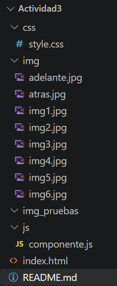
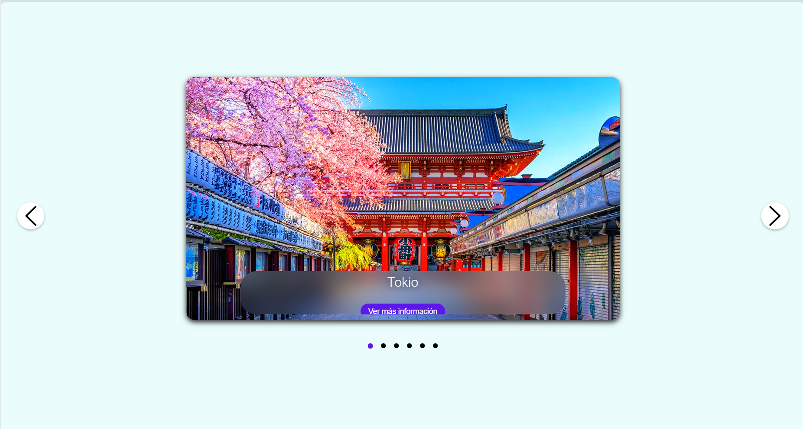
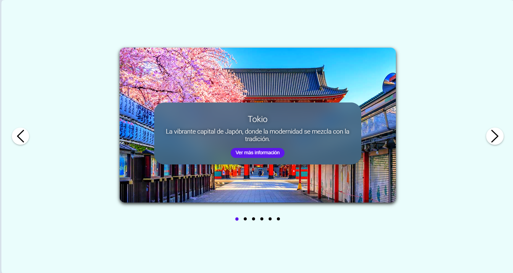
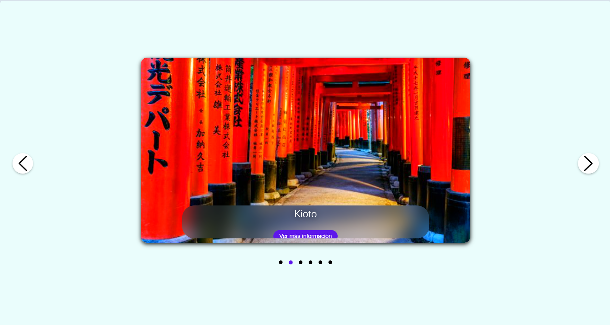

# Carrusel Interactivo de Japón - Actividad 3

**Autor:** Ruíz Jiménez Erandi Camila
> Este proyecto consiste en un **componente web interactivo (carrusel y modal)** desarrollado con tecnologías web estándar (HTML5, CSS3 y JavaScript moderno). Permite navegar de manera dinámica a través de imagenes de diferentes destinos turísticos de Japón, descripciones breves con efectos visuales y un **componente modal flotante** que despliega información detallada de cada lugar al hacer clic.

---

## Tecnologías Utilizadas

* **HTML:** Estructura semántica del carrusel, contenedores de texto y la ventana modal flotante.
* **CSS:** Estilos personalizados, diseño adaptable (Flexbox), efectos de difuminado (`backdrop-filter`), animaciones de apertura y transiciones fluidas.
* **JavaScript:** Lógica del carrusel, manipulación dinámica del DOM, gestión de un arreglo de objetos (con datos e información extendida) y control de eventos para la navegación y el modal.

---

## Estructura del Proyecto

El proyecto está organizado de la siguiente manera:



---

## Componentes y Código de Implementación

**1. Estructura HTML del Carrusel y el Modal**

```javascript
<div class="imagenes">
    <div id="img">
        
    </div>
    
    <div id="texto" class="texto">
        <h3>Japón</h3>
        <p>Lugares de Japón los cuales me gustaría visitar</p>
        <button id="btn-modal" class="btn-info">Ver más información</button>
    </div>
</div>

<div id="modal-info" class="modal">
    <div class="modal-contenido">
        <span id="cerrar-modal" class="cerrar">&times;</span>
        <h2 id="modal-titulo">Título</h2>
        <p id="modal-texto">Descripción detallada...</p>
    </div>
</div>
```

Esta sección define la arquitectura base de la página, organizando visualmente el carrusel y preparando el contenedor para la ventana flotante.

Cómo se compone:

* La imagen optimizada: Se incluye la etiqueta  principal con el atributo loading="lazy", lo cual permite que el navegador cargue las imágenes de forma diferida para mejorar el rendimiento de la página.

* El bloque de texto flotante: Agrupa el título (<h3>), la descripción corta (<p>) y el botón (#btn-modal) que sirve como disparador para mostrar la información extendida.

* La estructura del modal: Se integra el contenedor oculto (#modal-info) dotado de un botón de cierre tipográfico (&times;) y de espacios reservados (#modal-titulo y #modal-texto) que funcionarán como receptores dinámicos de contenido.

**2. Estilos CSS (El diseño visual, efectos hover y capas flotantes)**

Aquí se configuran todas las reglas estéticas, las transiciones de movimiento y el comportamiento visual de la ventana emergente.

```javascript
.imagenes:hover .texto {
    transition: height 1s, transform 1s, background-color 1s;
    transform: translateY(-100px);
    height: 180px;
    background-color: rgba(63, 106, 138, 0.85);
}

.modal {
    display: none;
    position: fixed;
    z-index: 100;
    left: 0;
    top: 0;
    width: 100%;
    height: 100%;
    background-color: rgba(0, 0, 0, 0.5); 
    backdrop-filter: blur(5px);
    justify-content: center;
    align-items: center;
}

.modal-contenido {
    background-color: white;
    padding: 30px;
    border-radius: 20px;
    width: 90%;
    max-width: 450px;
    text-align: center;
    box-shadow: 0px 5px 15px rgba(0,0,0,0.3);
}
```

Cómo se compone:

El efecto de expansión (Hover): Mediante la regla .imagenes:hover .texto, se programó una transición fluida que modifica la altura (height) y desplaza el cuadro de texto hacia arriba usando translateY(-100px), logrando un cambio visual muy elegante al colocar el cursor sobre la fotografía.

La capa de enfoque (Overlay): El contenedor .modal utiliza position: fixed para cubrir toda la pantalla. La propiedad clave backdrop-filter: blur(5px) aplica un difuminado estilo cristal sobre los elementos traseros, haciendo que la interfaz luzca profesional.

La caja central: El contenedor .modal-contenido estructura una tarjeta limpia con bordes redondeados (border-radius: 20px) y una sombra difuminada (box-shadow), asegurando que resalte perfectamente frente al fondo oscuro.

**3. Lógica en JavaScript (El comportamiento dinámico y gestión de datos)**

El script centraliza el funcionamiento inteligente del componente, conectando las acciones del usuario con la manipulación del DOM.

```javascript
const imagenes = [
    {
        url: "img/img1.jpg",
        nombre: "Tokio",
        descripcion: "La vibrante capital de Japón...",
        infoExtra: "Tokio es una de las metrópolis más grandes del mundo..."
    },
];

let actual = 0;
let btnModal = document.getElementById('btn-modal');
let modalInfo = document.getElementById('modal-info');
let modalTitulo = document.getElementById('modal-titulo');
let modalTexto = document.getElementById('modal-texto');

if (btnModal) {
    btnModal.addEventListener('click', () => {
        let itemActual = imagenes[actual];
        modalTitulo.innerText = itemActual.nombre;
        modalTexto.innerText = itemActual.infoExtra;
        modalInfo.style.display = 'flex';
    });
}
```

Cómo se compone:

* El modelo de datos: La información de los destinos se almacena en un arreglo de objetos (imagenes), lo que facilita la administración y escalabilidad del contenido sin modificar la estructura del HTML.

* El control de estado (actual): Mantiene un registro numérico de la posición en la que se encuentra el usuario dentro del carrusel.

* La sincronización del modal: A través de un escuchador de eventos (addEventListener enfocado en el clic del botón), el sistema detecta cuál es la imagen activa en ese momento (imagenes[actual]), extrae su propiedad de texto extendido (infoExtra), la inyecta en los elementos del modal y modifica la propiedad display de none a flex para desplegar la ventana emergente de forma sincronizada.

---

## Cómo Ejecutar el Proyecto

1. Clona o descarga este repositorio en tu computadora.

2. Mantén la estructura de carpetas (css, js e img) organizada.

3. Abre el archivo index.html directamente en tu navegador web o mediante un entorno local como Live Server.

---

## Demostración del SIstema

**Video Demostración del Sistema:** 
[Ver video en YouTube](https://youtu.be/nACaznBwoIo)

**Captutras finales**

>Carga inicial del componente e interfaz principal.



>Validación del efecto de expansión al pasar el cursor (Hover).



>Activación y despliegue del componente modal.


>Cambio de destino turístico mediante los controles de navegación.



---

## Referencias

DOCUMENT 0. (2023, febrero 10). Como Crear un Carrusel de Imágenes | EN MENOS DE 20 MIN | Html, Css y JavaScript [Video]. YouTube. https://www.youtube.com/watch?v=lpDAFrD_Rfg